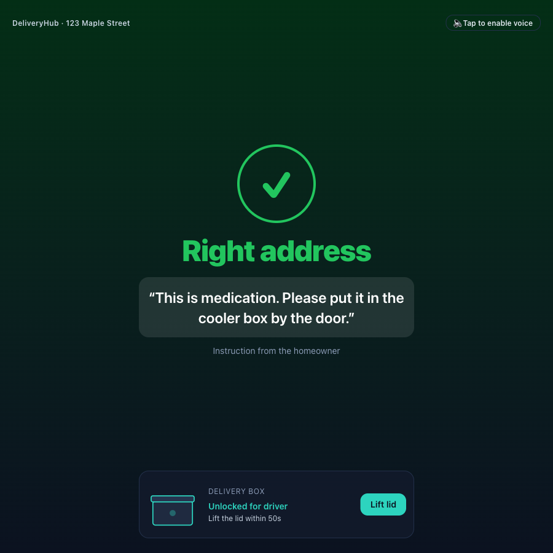
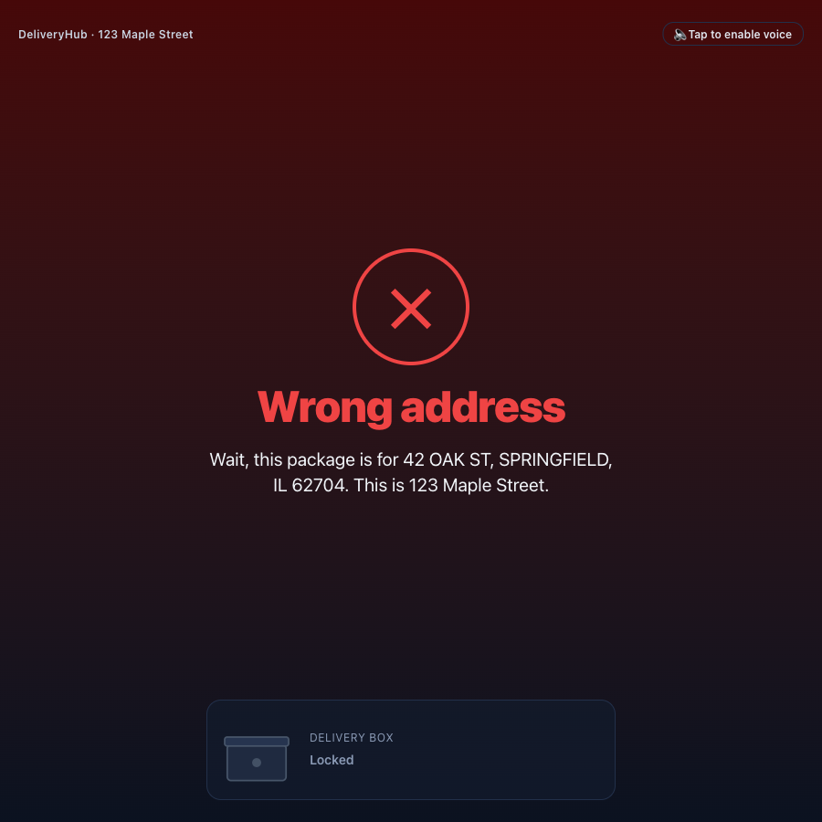
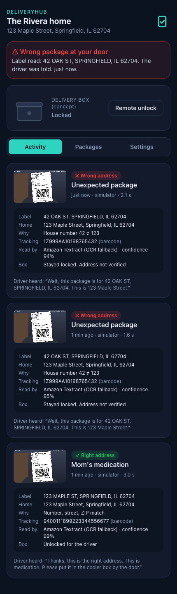
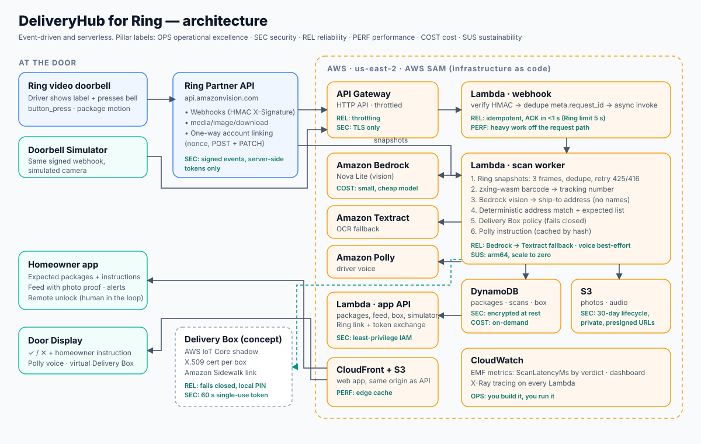

# DeliveryHub for Ring


**The driver just holds the label up to the Ring doorbell, hands-free, no button. DeliveryHub confirms it's the right house, marks the package delivered with photo proof, and tells the driver the homeowner's instructions for that package.**

Ring already knows *a* package is at the door. DeliveryHub knows *which* package it is and *whether it belongs here*.

> **Live demo:** https://dgnb2hmunowzj.cloudfront.net (no login; open on a laptop for the three-pane console)
>
> Built for the [Build, Ship, Shape: Amazon Developer Hackathon](https://amazonappdev2026.devpost.com/) — Ring track + AWS Builder mini challenge.

## Try it in 60 seconds

1. Open **https://dgnb2hmunowzj.cloudfront.net** on a laptop. No login.
2. In the left pane (**Doorbell Simulator**), keep "Medication" (the photo sample) selected and click **📦 Driver holds the label up (hands-free)**.
3. Watch the middle pane (**Door Display**) confirm the right house and show the homeowner's instruction (tap "enable voice" to hear it), then **Lift lid** / **Close lid** on the Delivery Box.
4. Watch the right pane (**homeowner app**): delivered, with photo proof and the reason.
5. Try **Neighbor's package**: wrong house, alert, box stays locked. **Settings → Reset demo data** starts over.

| Right house | Wrong house | Homeowner app |
|---|---|---|
|  |  |  |

## How it works



```
Ring doorbell ─ package-motion / button_press webhook (HMAC-signed) ─► API Gateway → webhook Lambda ── verify, dedupe, ACK < 1 s
 (or Doorbell Simulator: identical signed payload)                     │ async
                                                                       ▼
                                                       scan-worker Lambda
                                                         ├─ Ring media/image/download (2 frames, retry 425)
                                                         ├─ zxing-wasm barcode decode → tracking number
                                                         ├─ Amazon Bedrock (Nova Lite) vision → ship-to address
                                                         │    └─ fallback: Amazon Textract OCR
                                                         ├─ deterministic address match + expected-package lookup (DynamoDB)
                                                         ├─ Delivery Box unlock policy (fails closed)
                                                         └─ Amazon Polly instruction → S3 (30-day lifecycle)
Door Display (driver)  ◄─ poll ─ CloudFront ─► homeowner app (feed, photo proof, alerts, remote box unlock)
```

## Repo layout

| Path | What |
|---|---|
| `backend/src/core` | Pure, unit-tested logic: address matching, tracking lookup, decisions, Delivery Box policy and state machine |
| `backend/src/ring` | Ring Partner API client (OAuth refresh, snapshots), webhook parsing and HMAC verification |
| `backend/src/handlers` | Lambda handlers: `webhook`, `worker`, `api` |
| `infra/template.yaml` | AWS SAM: HTTP API, Lambdas, DynamoDB, S3, CloudFront, CloudWatch dashboard |
| `web/` | Demo console (`/`), homeowner app (`/home`), Door Display (`/door`), Doorbell Simulator (`/sim`), live eval (`/eval`) |
| `docs/` | [Submission pack](docs/SUBMISSION.md) · [Concept video script](docs/CONCEPT_VIDEO_SCRIPT.md) · [Concept video brief for Claude chat](docs/CLAUDE_CHAT_VIDEO_BRIEF.md) · [Eval results](docs/EVAL.md) · [Delivery Box design](docs/DELIVERY_BOX.md) · [PR-FAQ](docs/PR-FAQ.md) · [Friction log](docs/FRICTION_LOG.md) · [Product feedback](docs/PRODUCT_FEEDBACK.md) |

## Run the tests

```bash
make test
```

## Deploy

Requires AWS SAM CLI and an AWS profile (set `PROFILE=`; Region `us-east-2`).

```bash
# .env.deploy (gitignored): RING_CLIENT_ID, RING_CLIENT_SECRET, RING_WEBHOOK_SECRET (HMAC key), HOME_PASSCODE
make deploy
make deploy-web
make outputs
```

Then paste `RingWebhookUrl`, `RingAccountLinkUrl` and `RingTokenExchangeUrl` into the Ring Developer Portal (Account linking), and connect your Ring account from the Ring app.

## Privacy

- DeliveryHub only acts when a label is shown to the doorbell (Ring's package/person motion event, or a bell press). Frames without a label are discarded and never stored. No face recognition.
- Only the ship-to address and tracking number are extracted; the recipient name is never requested or stored.
- Snapshots are deleted automatically after 30 days (S3 lifecycle rule).
- Every decision shows the address read next to the home address, with the reason.

## License

MIT. See [LICENSE](LICENSE) and [NOTICE](NOTICE).
